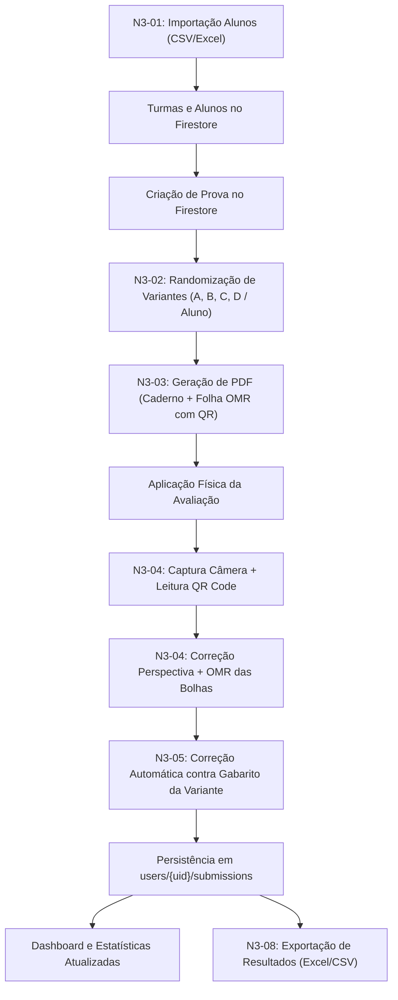

# Avalia Pro — Plano Técnico de Implementação (Entrega N3)

> **For agentic workers:** REQUIRED SUB-SKILL: Use superpowers:subagent-driven-development to implement this plan task-by-task. Steps use checkbox (`- [ ]`) syntax for tracking.

**Goal:** Transform the Avalia Pro Flutter mobile app into a 100% functional, production-ready assessment solution for the N3 milestone by replacing all existing mocks and placeholders with real, tested implementations for Student Import (Excel/CSV), Exam Randomization & Variants, Document Generation (PDF Exam & Answer Sheet with QR), OMR Computer Vision Scanning, Automated Grading, and CSV/Excel Export.

**Architecture:** Layered Feature-First Clean Architecture (Presentation, Domain/Services, Data/Repositories) backed by Cloud Firestore (`users/{uid}/...`), cross-platform pure-Dart image processing for OMR (`package:image`), standard document generation (`package:pdf`, `package:printing`), and multi-format parser/exporters (`package:csv`, `package:excel`).

**Tech Stack:** Flutter 3.13+, Dart 3, Cloud Firestore, Firebase Auth, `pdf`, `printing`, `camera`, `image`, `mobile_scanner`, `file_picker`, `csv`, `excel`, `path_provider`, `share_plus`.

**Spec:** Entrega N3 Specification (N3-01, N3-02, N3-03, N3-04, N3-05, N3-08, N3-10).

---

## 1. Resumo Executivo

O projeto **Avalia Pro** possui uma base visual robusta, estruturada em Flutter com Firebase Authentication e Cloud Firestore já operacionais para criação básica de turmas, alunos manuais e cadastro inicial de questões. Contudo, **as funcionalidades centrais da entrega N3 encontram-se atualmente simuladas ou ausentes**:
- A importação de alunos utiliza uma lista estática de 12 nomes simulados com `Future.delayed`.
- A randomização de provas não existe (apenas uma flag booleana sem lógica de variantes ou gabarito permutado).
- A geração de provas e folhas de resposta em PDF com QR Code não foi implementada.
- O scanner de QR Code e leitor de OMR são placeholders de interface (`CameraPlaceholder`) que geram respostas aleatórias via função de hash simulada.
- A exportação para Excel e CSV apenas simula uma barra de carregamento e exibe um diálogo fictício.
- Existem resquícios de arquivos legados em `lib/screens/` desacoplados da arquitetura moderna em `lib/features/`.

O presente plano estabelece o roteiro técnico detalhado para implementar cada subsistema de forma desacoplada, utilizando **Subagent-Driven Development (SDD)** com testes automatizados pré e pós-implementação.

---

## 2. Diagnóstico Técnico

### 2.1 Arquitetura e Estrutura de Diretórios
- **Camada de Apresentação:** Flutter widgets com `ThemeData` centralizado (`lib/core/theme/app_theme.dart`) e componentes reutilizáveis em `lib/core/widgets/`.
- **Arquitetura Atual:** Mista. Coexistem a estrutura recomendada em `lib/features/` (access, classes, exams, correction, results, statistics, export, dashboard) e uma estrutura legada em `lib/screens/` (correcao, provas, config).
- **Banco de Dados (Cloud Firestore):** Estrutura hierárquica por usuário autenticado (`users/{uid}/...`), garantindo isolamento total por meio das regras em `firestore.rules`:
  - `users/{uid}/classes/{classId}` e subcoleção `students/{studentId}`
  - `users/{uid}/exams/{examId}` e subcoleção `questions/{questionId}`
  - `users/{uid}/submissions/{submissionId}`
- **Dependências atuais no pubspec.yaml:** `firebase_core`, `firebase_auth`, `cloud_firestore`, `cupertino_icons`.
- **Dependências faltantes obrigatórias:**
  - `file_picker` (seleção de arquivos Excel/CSV e imagens)
  - `csv` (leitura e geração de planilhas CSV com RFC 4180 e UTF-8 BOM)
  - `excel` (leitura e geração de planilhas XLSX multi-abas)
  - `pdf` e `printing` (geração vetorial de provas e folhas de resposta A4)
  - `image` (processamento de imagem puro em Dart: perspectiva, threshold e OMR sem dependências de C++ nativo instáveis no Windows)
  - `camera` ou `mobile_scanner` (captura em tempo real pela câmera do celular)
  - `path_provider` e `share_plus` (armazenamento temporário e compartilhamento de arquivos)

---

## 3. Matriz de Status das Tarefas (Entrega N3)

| ID | Tarefa | Status Atual | Diagnóstico Resumido |
| :--- | :--- | :--- | :--- |
| **N3-01** | Importação de alunos | **Com problemas / Mock** | Interface existe, mas lê lista estática de 12 nomes simulados (`_alunosMock`). Sem leitor de arquivos, sem suporte a CSV/Excel, sem campos de matrícula. |
| **N3-02** | Randomização de provas | **Não implementada** | Existe apenas a flag `sameExamForEveryone` no formulário. Nenhuma lógica de embaralhamento de questões/alternativas ou cálculo de gabaritos por variante. |
| **N3-03** | Geração de provas e folhas de respostas | **Não implementada** | Nenhuma biblioteca de PDF/impressão no projeto. Sem layout de prova, sem folha de respostas com marcadores de canto e QR Code. |
| **N3-04** | Leitura automatizada (QR Code e OMR) | **Com problemas / Mock** | `CameraPlaceholder` estático. `Future.delayed` simula leitura do QR e captura da folha. Sem integração com câmera nem algoritmo OMR. |
| **N3-05** | Correção automática e cálculo de notas | **Com problemas / Mock** | Gera respostas com base no `hashCode` do nome do aluno (`seed % 10 >= 2`). Não confronta a folha lida contra o gabarito da variante correta. |
| **N3-08** | Exportação de resultados | **Com problemas / Mock** | `export_screen.dart` é 100% mock. Simula barra de progresso e exibe popup fictício de compartilhamento sem gerar arquivos nem ler dados do Firestore. |
| **N3-10** | Integração e testes gerais | **Parcialmente implementada** | Autenticação e estatísticas básicas possuem testes funcionais; porém o fluxo E2E está interrompido pelos mocks intermediários. Código legado em `lib/screens/` precisa de migração. |

---

## 4. Análise Detalhada por Tarefa

### N3-01 — Importação de Alunos
- **Estado atual:** `lib/features/classes/importacao_alunos_screen.dart` possui fluxo de passos na interface, mas aciona `Future.delayed(600ms)` e injeta `_alunosMock` (12 strings de nomes) em `ClassRepository.addStudents`.
- **Pendências:** Falta selecionar arquivo real do dispositivo (.csv, .xlsx, .xls); falta interpretar cabeçalhos (Nome, Matrícula, Email); falta validação de linhas inválidas, campos vazios e alunos duplicados.
- **Implementações:**
  1. Adicionar `file_picker`, `csv`, `excel` ao `pubspec.yaml`.
  2. Expandir `StudentRecord` para conter `matricula` e `email`.
  3. Criar `StudentImportService` com parsing resiliente (delimitadores `,`, `;`, `\t`; encodings UTF-8 e ISO-8859-1).
  4. Implementar tela de prévia de importação com exibição de linhas válidas, duplicadas e alertas antes da confirmação.
  5. Salvar em batch no Firestore em lotes de até 400 registros.

### N3-02 — Randomização de Provas
- **Estado atual:** O modelo `ExamRecord` apenas armazena `sameExamForEveryone` como booleano.
- **Pendências:** Não existem modelos para representar variantes (`ExamVariant`), nem serviço de embaralhamento que recalcula o gabarito de cada questão quando as alternativas mudam de posição.
- **Implementações:**
  1. Criar modelo `ExamVariant` e `VariantQuestionMapping` com `answerKey: Map<int, String>`.
  2. Criar `ExamRandomizerService`:
     - Modo A (Mesma prova): Gera $N$ variantes (ex: Tipos A, B, C, D) com permutação pseudo-aleatória de questões e alternativas.
     - Modo B (Individual): Gera 1 variante individual por aluno matriculado na(s) turma(s).
     - Rastreamento exato: garante que se a alternativa correta original era a opção "A", e foi movida para a posição "D", o gabarito da variante aponte infalivelmente para "D".
  3. Persistir as variantes geradas em `users/{uid}/exams/{examId}/variants/{variantId}`.

### N3-03 — Geração de Provas e Folhas de Respostas
- **Estado atual:** Inexistente.
- **Pendências:** Falta criar templates PDF tanto do caderno de questões quanto do cartão de respostas.
- **Implementações:**
  1. Adicionar dependências `pdf` e `printing`.
  2. Criar `ExamPdfService`:
     - Caderno de Questões: Cabeçalho institucional, dados da prova e da variante, questões numeradas com alternativas A-E em diagramação profissional multi-páginas.
     - Folha de Respostas OMR: Formato A4 com 4 marcadores fiduciais pretos nos cantos (essenciais para alinhamento e correção de perspectiva), QR Code no cabeçalho contendo `AVALIA:1.0|{examId}|{variantId}|{studentId}`, instruções claras e grade de bolhas circulares padronizadas com coordenadas geométricas fixas.
  3. Criar tela de pré-visualização e impressão (`ExamPrintScreen`).

### N3-04 — Leitura Automatizada das Folhas de Respostas (QR Code e OMR)
- **Estado atual:** Placeholder estático com temporizador simulando sucesso.
- **Pendências:** Falta acesso à câmera / galeria, leitura real de QR Code, detecção dos marcadores da folha, correção de perspectiva (warp) e medição de preenchimento das bolhas.
- **Implementações:**
  1. Adicionar `camera`, `mobile_scanner` e `image`.
  2. Implementar `OmrScannerService`:
     - Leitura do QR Code para identificar prova, variante e aluno.
     - Localização dos 4 cantos da folha (marcadores fiduciais).
     - Transformação de perspectiva para um retângulo canônico plano (ex: 1000x1414 px).
     - Amostragem de luminância pixel a pixel em cada bolha da grade OMR.
     - Classificação: Marcada (fill > threshold), Não respondida (em branco), ou Marcação inválida (dupla marcação).
  3. Criar viewfinder interativo com grade de alinhamento e tela de revisão manual (permitindo ao professor ajustar visualmente se houver rasura antes de confirmar).

### N3-05 — Correção Automática e Cálculo de Notas
- **Estado atual:** Simulação por hash em `leitura_gabarito_screen.dart`.
- **Pendências:** O sistema precisa confrontar as marcações detectadas pelo OMR contra o gabarito real da `ExamVariant` correspondente.
- **Implementações:**
  1. Criar `ExamGradingService`:
     - Cruza `Map<int, String?> recognizedAnswers` com `variant.answerKey`.
     - Identifica acertos, erros, questões em branco, questões com dupla marcação e questões anuladas.
     - Calcula nota e percentual conforme o peso configurado.
  2. Atualizar `SubmissionRecord` para armazenar `variantId`, detalhes por questão e status da correção.
  3. Persistir os resultados em `users/{uid}/submissions/`.

### N3-08 — Exportação de Resultados
- **Estado atual:** Tela puramente figurativa com delays e erro simulado.
- **Pendências:** Nenhum dado é extraído do Firestore e nenhum arquivo é gerado.
- **Implementações:**
  1. Criar `ResultExportService`:
     - Exportação CSV: Formato RFC 4180 com codificação UTF-8 com BOM (`\uFEFF`) para compatibilidade perfeita com Excel em português.
     - Exportação Excel (XLSX): Pasta de trabalho com aba de notas gerais, aba de matriz de respostas por questão e aba de métricas estatísticas da turma.
  2. Integrar com `share_plus` e `path_provider` para download e compartilhamento no dispositivo.

### N3-10 — Integração e Testes Gerais
- **Estado atual:** Testes isolados de auth e estatísticas funcionam, mas o app possui alto acoplamento com mocks.
- **Pendências:** Eliminação de todos os mocks, consolidação das telas legadas de `lib/screens/` para `lib/features/`, e criação de suíte completa de testes de regressão e fluxo E2E.

---

## 5. Fluxo de Integração da Aplicação



---

## 6. Plano Técnico de Implementação Detalhado

O desenvolvimento será executado em **7 etapas sequenciais** utilizando Subagent-Driven Development.

### Etapa 1: Fundação, Modelos e Dependências (Fundação N3)
- Adicionar ao `pubspec.yaml`: `file_picker`, `csv`, `excel`, `pdf`, `printing`, `camera`, `image`, `path_provider`, `share_plus`.
- Atualizar modelo `StudentRecord` (incluir campos matrícula e email).
- Criar modelos `ExamVariant`, `VariantQuestionMapping` e `VariantAlternative`.
- Executar `flutter pub get` e validar compilação.

### Etapa 2: N3-01 — Importação de Alunos
- Implementar `StudentImportService` com TDD (testes para CSV delimitado por vírgula/ponto-e-vírgula, Excel .xlsx, tratamento de cabeçalhos acentuados, remoção de duplicados).
- Refatorar `ImportacaoAlunosScreen` para permitir seleção de arquivos físicos via `FilePicker`.
- Adicionar tabela interativa de pré-visualização (linhas aprovadas, alertas e rejeitadas).
- Integrar com `ClassRepository.addStudents` com suporte a matrícula e transações em lote.

### Etapa 3: N3-02 — Randomização de Provas e Variantes
- Implementar `ExamRandomizerService` com TDD:
  - Embaralhamento determinístico e com semente.
  - Permutação de ordem de questões.
  - Permutação de alternativas A-E preservando a correspondência da resposta correta.
  - Suporte aos dois modos: Mesma prova (variantes pré-fixadas A-D) e Prova por aluno.
- Atualizar `ExamRepository` para salvar e consultar subcoleção `variants`.
- Conectar `ExamFormScreen` e `ProvaQuestoesScreen` para acionar a geração de variantes ao salvar a prova.

### Etapa 4: N3-03 — Geração de Provas e Folhas de Respostas
- Implementar `ExamPdfService`:
  - Diagramação do caderno de questões (A4 multi-páginas, fontes limpas, cabeçalho e identificação da variante).
  - Folha de resposta OMR: 4 marcadores de canto de 20x20 pt, QR Code superior com dados padronizados (`AVALIA:1.0|...`), grade de bolhas com espaçamento rigorosamente definido.
- Implementar tela `ExamPrintScreen` com `PdfPreview` e ações de imprimir / compartilhar.

### Etapa 5: N3-04 e N3-05 — Scanner OMR e Correção Automática
- Implementar `OmrImageService` com testes de unidade puros (usando imagens de teste sintéticas):
  - Algoritmo de correção de perspectiva baseado em 4 cantos.
  - Binarização e amostragem de densidade das bolhas.
  - Tratamento de marcações em branco, válidas e duplicadas.
- Implementar `ExamGradingService` com TDD (comparação com gabarito da variante, questões anuladas, pesos, cálculo de nota final).
- Criar tela de câmera real `OmrScannerScreen` substituindo o mock `CameraPlaceholder`:
  - Leitura de QR Code para identificar variante.
  - Processamento da folha e tela de revisão/ajuste manual de marcações antes da confirmação.
- Conectar a gravação em `SubmissionRepository`.

### Etapa 6: N3-08 — Exportação de Resultados
- Implementar `ResultExportService` com TDD:
  - Geração de CSV estruturado (RFC 4180 com BOM UTF-8).
  - Geração de planilha Excel (.xlsx) com múltiplas abas formatadas.
- Refatorar `ExportScreen` para carregar turmas e provas reais do Firestore e oferecer download/compartilhamento real via `share_plus`.

### Etapa 7: N3-10 — Consolidação, Limpeza de Mocks e Testes E2E
- Migrar componentes remanescentes de `lib/screens/` para `lib/features/`.
- Deletar arquivos obsoletos (como `mock_statistics_repository.dart`).
- Criar suíte abrangente de testes de integração cobrindo o ciclo completo (Importação -> Prova -> Randomização -> Folha -> Scanner -> Correção -> Exportação).
- Garantir 100% de passagem nos testes e código sem warnings do linter.

---

## 7. Estratégia de Subagent-Driven Development (SDD)

Para garantir velocidade, isolamento de escopo e zero conflito em arquivos compartilhados:

```
┌─────────────────────────────────────────────────────────────┐
│                   ETAPA 1: ORQUESTRADOR                     │
│         Atualiza pubspec.yaml, Modelos Base & Repos          │
└──────────────┬───────────────────────────────┬──────────────┘
               │                               │
┌──────────────▼──────────────┐ ┌──────────────▼──────────────┐
│        SUBAGENTE A          │ │        SUBAGENTE B          │
│ N3-01: Importação de Alunos │ │ N3-02: Randomização Provas  │
│ - StudentImportService      │ │ - ExamRandomizerService     │
│ - Tela Importação & Previa  │ │ - Variantes & Gabaritos     │
└──────────────┬──────────────┘ └──────────────┬──────────────┘
               │                               │
               └──────────────┬────────────────┘
                              │
┌─────────────────────────────▼───────────────────────────────┐
│                        SUBAGENTE C                          │
│        N3-03: Geração de Provas e Folhas OMR em PDF         │
│        - ExamPdfService (Caderno de Questões + Folha)       │
│        - ExamPrintScreen & Pré-visualização                 │
└─────────────────────────────┬───────────────────────────────┘
                              │
┌─────────────────────────────▼───────────────────────────────┐
│                        SUBAGENTE D                          │
│     N3-04 & N3-05: Visão Computacional (OMR) & Correção     │
│     - OmrImageService (Perspectiva & Densidade de Bolhas)   │
│     - ExamGradingService & OmrScannerScreen Real            │
└─────────────────────────────┬───────────────────────────────┘
                              │
┌─────────────────────────────▼───────────────────────────────┐
│                        SUBAGENTE E                          │
│               N3-08: Exportação de Resultados               │
│               - ResultExportService (CSV & Excel)           │
│               - ExportScreen Real & Compartilhamento        │
└─────────────────────────────┬───────────────────────────────┘
                              │
┌─────────────────────────────▼───────────────────────────────┐
│                   ETAPA FINAL: INTEGRADOR                   │
│        N3-10: Limpeza de Mocks, Refatoração & Testes E2E    │
└─────────────────────────────────────────────────────────────┘
```

---

## 8. Plano de Testes e Validação

1. **Testes Unitários:**
   - `StudentImportServiceTest`: CSVs válidos, CSV com separador `;`, arquivos vazios, colunas ausentes, caracteres acentuados, duplicatas.
   - `ExamRandomizerServiceTest`: Conferência de permutação em 100 iterações, garantindo que a resposta correta nunca seja perdida ou associada à alternativa errada.
   - `ExamGradingServiceTest`: Acerto total, erro total, folha toda em branco, marcações duplas, questões anuladas com atribuição de ponto integral.
   - `OmrImageServiceTest`: Imagens sintéticas de folhas simulando rotação/inclinação e diferentes níveis de preenchimento de bolha.
   - `ResultExportServiceTest`: Validação do conteúdo das planilhas geradas e encoding UTF-8 com BOM.
2. **Testes de Widgets e Integração:**
   - Renderização das telas de importação, visualização do PDF, leitor de correção e exportação sem crash.
   - Teste de fluxo completo com repositórios em memória / Firestore emuladores.

---

## 9. Riscos Técnicos e Medidas de Mitigação

1. **Variações de Iluminação e Ângulo no OMR:**
   - *Risco:* Câmeras de celulares tirando fotos inclinadas ou com sombras sobre as bolhas.
   - *Mitigação:* 4 marcadores de canto pretos de alto contraste na folha de resposta A4 para homografia geométrica + limiarização adaptativa local (Otsu / Sauvola) + tela de conferência humana permitindo que o professor veja as marcações detectadas e corrija ambiguidades antes de salvar.
2. **Compatibilidade Multiplataforma para Testes:**
   - *Risco:* Plugins de câmera nativa podem falhar em ambiente desktop de testes.
   - *Mitigação:* Disponibilizar no scanner a opção de capturar pela câmera E de selecionar imagem da galeria/arquivo, permitindo testes automatizados e validação rápida em emuladores e desktop.
3. **Limite de Transações no Firestore:**
   - *Risco:* Importação de turmas com centenas de alunos estourar o limite de 500 operações por batch do Firestore.
   - *Mitigação:* Quebrar lotes de gravação em blocos seguros de 400 documentos.

---

## 10. Checklist Final de Entrega N3

- [x] Importação de alunos funcional via CSV e Excel (.xlsx) com validação de duplicados e matrículas.
- [x] Randomização de questões e alternativas funcional com recálculo estrito do gabarito por variante.
- [x] Geração de cadernos de prova e folhas de respostas OMR em PDF vetorial com QR Code e marcadores fiduciais.
- [x] Leitor de folhas via câmera / imagem real com detecção de QR Code, ajuste de perspectiva e leitura OMR de bolhas.
- [x] Motor de correção automática confrontando marcações com o gabarito da variante correta.
- [x] Exportação completa de resultados e matrizes de resposta para CSV e Excel (.xlsx).
- [x] Todos os dados mockados e temporizadores fictícios removidos do código.
- [x] 100% dos testes unitários e de integração passando sem erros.

